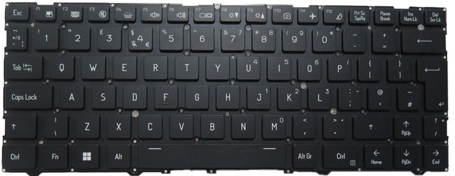

# Lemur Pro 13 (LEMP13) - Clevo L240TU keyboard layout

This could be useful for anyone looking to fix a faulty keyboard on their Lemur Pro 13 or maybe improve its arrow key layout.
I bought the lemp13 second-hand with a broken TAB key. I also disliked the original arrow key layout which is why I got a Replacement. System76 seems to have received similar feedback, as newer lemp13b revisions come with a different keyboard layout.
If you broke your System76 Keyboard and System76 is the only place where you can find this particular odd layout on the Clevo series, you might have also bought a replacement keyboard with the differrent layout.
An Image of the Replacement Keyboard is below, there is also another Keyboard Variant with slim Up&Down Keys but I can not verify that this Layout will work for it as well, it would also require a differrent Keyboard Top to fit on a regular lemp13.

It is also possible to swap individual keycaps on your existing keyboard if yours is fully working and you want to rearrange the arrow keys. I did this myself to replace the Windows key with the Super key from the original keyboard.
Be careful when doing this, as the keycaps can break very easily. It is easiest to work with the keyboard outside its shell, although removing it requires taking out lots of tiny screws and disconnecting the backlight.

If you want to swap keycaps, I recommend holding the key down and slowly use a thin prying tool underneath it from the left or right side of the Key. Do it carefully and try to release the bottom Clips first. I used a thin iFixit metal prying tool for this.
Manually swapping the arrow keys on your existing System76 keyboard should work, but keep in mind that this keymap also changes a few other smaller keys to match the Clevo keyboard layout.

## What Keys are differrent in this Layout

Keys
- Up and Slash swapped
- Down and Right swapped
- Insert and Pause swapped

Fn Layer
- Mic Mute moved from F2 to 4, F2 is now Display Toggle
- Pause added Break, Del added Scroll Lock
- Numpad on the letter keys
- 7 8 9 -> Num 7 8 9
- U I O P -> Num 4 5 6 /
- J K L -> Num 1 2 3 -
- M -> Num 0
- Period -> Num *
- Enter -> Num Enter
- Insert -> Num Lock
- Slash -> Num +

See the replacements layout below:



To use the different layout, you need to flash the new keymap onto the device.

Steps

1. Dependencies
```bash
sudo apt update
sudo apt install git
git clone https://github.com/Bush-cat/system76-lemp13-clevo-keyboard.git
cd system76-lemp13-clevo-keyboard
./scripts/deps.sh
sudo apt install avr-libc avrdude ca-certificates curl gcc gcc-avr libc-dev libhidapi-dev libudev-dev make pkgconf reuse sdcc shellcheck uncrustify xxd
```

2. Unlock Flashing

Enable Flashing of the Chip by setting PrepareUnlock

```bash
sudo ./scripts/ectool.sh security unlock
```

Shutdown your Device. It will automatically boot again and ask you to write the displayed enable flashing during the next power-on. After a second boot it will become locked again.

3. Build & Flash

Now you can Build and flash the keymap for your device.

> Warning, this will automatically shutdown your Device!

> Do not press anything on the Laptops Keyboard or Touchpad while it is flashing!

```bash
sudo make BOARD=system76/lemp13 KEYMAP=clevo_l240tu flash_internal
```

After your Device has shut down. You might have to press the Power Button twice to start it again.

# System76 EC

System76 EC is a GPLv3 licensed embedded controller firmware for System76
laptops.

## Documentation

- [Supported embedded controllers](./docs/controllers.md)
- [Flashing firmware](./docs/flashing.md)
- [Debugging](./docs/debugging.md)
- [Creating a custom keyboard layout](./docs/keyboard-layout-customization.md)
- [Development environment](./docs/dev-env.md)
- [Adding a new board](./docs/adding-a-new-board.md)

## Quickstart

Install dependencies using the provided script.

```sh
./scripts/deps.sh
```

If rustup was installed as part of this, then the correct `cargo` will not be
available in the running session. Start a new shell session or source the env
file to update `PATH`.

```sh
source $HOME/.cargo/env
```

Then build the firmware for your laptop model.

```sh
make BOARD=system76/<model>
```

See [Flashing](./docs/flashing.md) for how to use the new firmware image.

## Releases

The EC firmware itself does not have tagged releases. Any commit of this repo
may be used as a part of a [System76 Open Firmware][firmware-open] release.

In official releases the EC shares the same version as the BIOS firmware. Run
the follow command from firmware-open to determine the corresponding EC commit
for a release.

```
git ls-tree <release_hash> ec
```

[firmware-open]: https://github.com/system76/firmware-open

## Legal

System76 EC is copyright System76 and contributors.

System76 EC firmware is made available under the terms of the GNU General
Public License, version 3. See [LICENSE](./LICENSE) for details.

- firmware: GPL-3.0-only
- ecflash: LGPL-2.1-or-later
- ecsim: MIT
- ectool: MIT

Datasheets for the ITE embedded controllers used in System76 laptops cannot be
shared outside of company. (However, the IT81202 datasheet is [publicly
available][it81202]. While it uses a different core, a significant portion of
the register information is the same as IT8587/IT5570.)

[it81202]: https://www.ite.com.tw/en/product/cate2/IT81202
